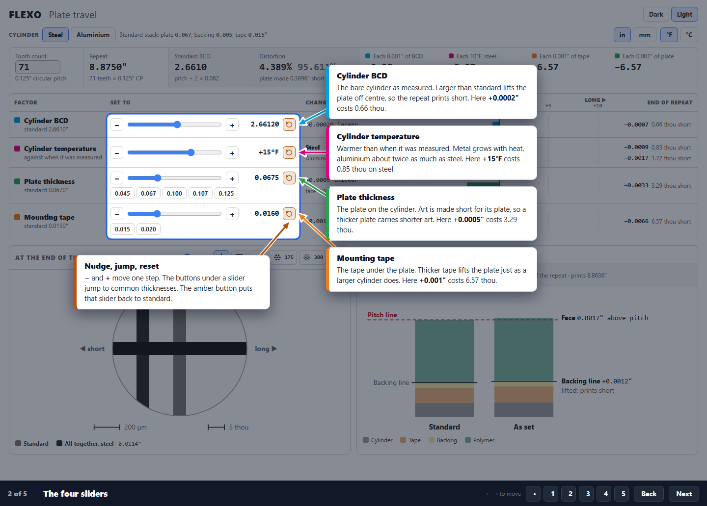

# FLEXO Plate travel

A one-file simulator of how far the end of a flexo print repeat moves when the plate cylinder, its temperature, the plate or the mounting tape is off the standard, as a whole or at four readings across the face.

- **Simulator:** [FLEXO_PLATE_DRIFT.html](https://magicphase.github.io/Flexo_Drift_Sim/FLEXO_PLATE_DRIFT.html)
- **Demo walkthrough:** [FLEXO_PLATE_DRIFT_DEMO.html](https://magicphase.github.io/Flexo_Drift_Sim/FLEXO_PLATE_DRIFT_DEMO.html)
- **The maths:** [FLEXO_PLATE_DRIFT_MATH.html](https://magicphase.github.io/Flexo_Drift_Sim/FLEXO_PLATE_DRIFT_MATH.html)

## The simulator

Type a tooth count. The top row gives the repeat, the standard BCD, the distortion (how much shorter the plate is made, and what is left of the repeat), what a small step of each factor is worth, and the units the page reads in: inches or millimetres, °F or °C.

Everything is set on the left and shown on the right.

### On the left: one place to set things

Four factors, each a row in its own colour:

| Factor | What it is |
| --- | --- |
| Cylinder BCD | The bare cylinder diameter as measured, against the standard BCD |
| Temperature | How much warmer or colder the cylinder runs than when it was measured |
| Plate thickness | The plate on the cylinder |
| Mounting tape | The tape under the plate |

Each row shows what the factor is set to, a bar on one shared short / long scale, and the travel at the end of the repeat in inches and thousandths (or millimetres and micrometres). The amber button at the end of a row puts that factor back to standard.

Click a row to take that factor in hand. Under the list:

- **One slider** moves the factor in hand as a whole. The buttons under it jump to common thicknesses, or pick steel or aluminium when temperature is in hand.
- **A cut through the cylinder** shows the cylinder, the tape and the plate with four readings across the face. Drag a point, or use the steppers under it, to make the BCD, the tape or the plate differ at that reading. Click a layer's colour strip to take that layer in hand.
- **Plate: Stiff | Follows** chooses how the plate takes those differences (see below).

### On the right: at the end of the repeat

Three views, in six test patterns:

- **All together:** a magnified view with the standard in grey and the four changes together in black. On the two rosettes the view splits: standard on the left, as set on the right.
- **Each:** four lenses, one factor alone in each, in its own colour and all at one scale.
- **Across the face:** the plate laid flat with a lens at each corner, and four figures: out of square, the difference between the diagonals, the bow of the tail edge and how far the tail has moved sideways. The plate width is typed here.

It is a single HTML file with nothing to install. It loads nothing and saves nothing. Add `#example` to the address to open it with a small example set, or `#light` for the light theme.

## The demo

Seven stops over two light screenshots of the simulator: the page dims, one part stays lit, and a few bubbles explain it. Move with the ← → keys, the Back and Next buttons, or the numbered dots. The same seven stops are in `FLEXO_PLATE_DRIFT_DEMO_files/` as images, `slide-0.png` to `slide-6.png`.

The demo is a picture of the simulator, not the simulator: nothing in it moves.

## The maths

A companion note: the formulas the simulator runs, the constants it uses, figures by tooth count, checks against published examples, the across-the-face geometry, what the model leaves out, and the sources.

## What the figures assume

- **A fixed gear.** The repeat is the tooth count times the circular pitch (0.125"). The gear sets how fast the cylinder turns, and the art keeps its length at the plate's backing. Anything that lifts the backing further from the centre prints short; anything that lowers it prints long.
- **The standard stack** is a 0.067" plate with a 0.005" backing on 0.015" tape. The standard BCD is the cylinder diameter that puts that plate's face on the gear's pitch line.
- **Art made for the plate in use.** A thicker plate carries shorter art, so on a cylinder cut for the standard plate it prints short.
- **Only the cylinder grows with heat:** 6.5 × 10⁻⁶ per °F for steel and 13.1 × 10⁻⁶ per °F for aluminium.
- **Four readings, evenly spaced** from one edge of the plate to the other. A thicker spot in the plate counts at its reading the way a thicker plate does.
- **Stiff and Follows are the two limits.** A plate that follows prints each reading at its own length, so the tail edge bends and nothing moves sideways. A stiff plate will not stretch: it sits on the straight taper through the four readings and, laid square at the lead edge, walks toward the large end by the tail. A real plate lies between the two. No stiffness figure is used.

These are a model for showing which factor matters most, not a measurement of any press. The across-the-face figures are the model's own geometry and have not been checked on a press.
